# SouverainRecrut — Chaîne CI/CD du Backend

**Martin BELLOT** · M2 · SUP DE VINCI Rennes · RNCP 40166 · Projet CI/CD · novembre 2026

| | |
|---|---|
| Dépôt (code, CI, infrastructure) | [github.com/MartinBellot/souverainrecrut — branche `Dev`](https://github.com/MartinBellot/souverainrecrut/tree/Dev) |
| Projet de déploiement | [gitlab.com/martin.bellot.off/souverainrecrut](https://gitlab.com/martin.bellot.off/souverainrecrut) |
| Image Docker | [hub.docker.com/r/martinbellot/souverainrecrut-backend](https://hub.docker.com/r/martinbellot/souverainrecrut-backend) |
| API en production | http://148.230.115.48:4000/v1/info · [Swagger](http://148.230.115.48:4000/api-docs/) |

## Sommaire

1. [Synthèse](#1-synthèse)
2. [Architecture](#2-architecture)
3. [Qualité : tests et SonarQube](#3-qualité--tests-et-sonarqube)
4. [Intégration continue : Jenkins](#4-intégration-continue--jenkins)
5. [Image Docker et sécurité](#5-image-docker-et-sécurité)
6. [Infrastructure : Terraform et Ansible](#6-infrastructure--terraform-et-ansible)
7. [Déploiement : Docker Compose et GitLab CI](#7-déploiement--docker-compose-et-gitlab-ci)
8. [Vérification, rollback et données](#8-vérification-rollback-et-données)
9. [Gestion des secrets](#9-gestion-des-secrets)
10. [Conformité aux exigences](#10-conformité-aux-exigences)
11. [Défauts détectés et corrigés](#11-défauts-détectés-et-corrigés)
12. [Limites et pistes](#12-limites-et-pistes)
13. [Procédures de référence](#13-procédures-de-référence)

---

## 1. Synthèse

Une modification du Backend poussée sur `Dev` est **testée, analysée, construite, scannée et publiée** automatiquement par Jenkins. Elle est ensuite **déployée sur approbation** par GitLab CI sur un serveur provisionné par Terraform et Ansible.

| Indicateur | Résultat |
|---|---|
| Tests | **330** (244 unitaires · 64 intégration · 22 E2E), tous verts |
| Couverture | **100 %** (lignes, branches, fonctions) |
| SonarQube | Quality Gate **PASSED** · 0 bug · 0 vulnérabilité · 0 code smell · 0 % duplication |
| Trivy | **0** vulnérabilité bloquante · 0 secret dans l'image |
| Image | `martinbellot/souverainrecrut-backend:<version>-<commit>` (linux/amd64) |
| Production | API + PostgreSQL sur le VPS, déployés et vérifiés par GitLab CI |
| Continuité | Rollback testé (automatique, par job GitLab, et restauration de la base) |
| Secrets | 0 dans le dépôt (13 commits analysés), 0 dans les journaux CI |

---

## 2. Architecture

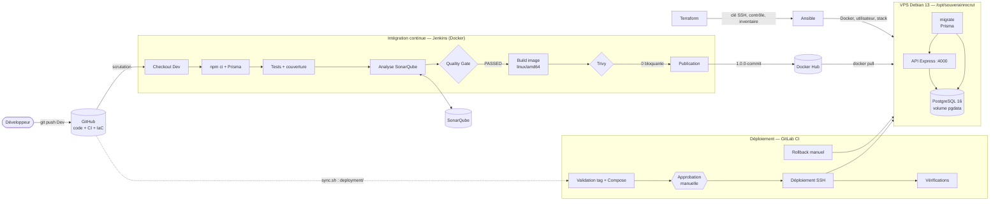

| Outil | Rôle | Où il tourne |
|---|---|---|
| **GitHub** | Source unique : code, tests, `Jenkinsfile`, Terraform, Ansible, `deployment/` | SaaS |
| **Jenkins** | Intégration continue : tests → SonarQube → image → Trivy → Docker Hub | Conteneur local (`docker-compose.ci.yml`) |
| **SonarQube** | Qualité, sécurité et couverture, Quality Gate bloquant | Conteneur local |
| **Trivy** | Scan des vulnérabilités et des secrets de l'image | Dans l'image Jenkins |
| **Docker Hub** | Registre des images versionnées | SaaS |
| **Terraform** | Clé de déploiement, contrôle du serveur, inventaire Ansible | Poste d'administration |
| **Ansible** | Configuration du serveur et installation initiale de la stack | Poste d'administration → VPS |
| **GitLab CI** | Déploiement continu avec approbation, vérification et rollback | SaaS (runners GitLab) |
| **Docker Compose** | Orchestration API + PostgreSQL sur le serveur | VPS |

**Choix structurants**
- **Séparer CI et CD** : Jenkins *produit* une image vérifiée, GitLab la *déploie*. Le serveur ne reconstruit jamais l'image : ce qui est déployé est exactement ce qui a été testé et scanné.
- **Une source unique pour le déploiement** : le dossier `deployment/` est utilisé à la fois par Ansible (installation) et par GitLab (mises à jour). Le projet GitLab en est une copie générée par `gitlab-deploy/sync.sh`.
- **Tout en code** : Jenkins (JCasC), Quality Gate (script), infrastructure (Terraform, Ansible), déploiement (Compose, scripts). Une procédure manuelle n'est jamais nécessaire.
- **Pas de VMware** : le déploiement cible un VPS existant (Debian 13), qui héberge aussi d'autres services. Toutes les opérations ont donc été conçues pour être **non intrusives** (stack, réseau et volume isolés, aucun redémarrage imposé).

```
souverainrecrut/
├── backend/            API (Express, Prisma), tests, Dockerfile, sonar-project.properties
├── Jenkinsfile         pipeline CI
├── ci/                 image Jenkins (JCasC, plugins), script du Quality Gate
├── terraform/          main.tf, variables.tf, outputs.tf, providers.tf
├── ansible/            inventory.ini, playbook.yml, templates
├── deployment/         docker-compose.yml, .env.example, deploy.sh, restore.sh
├── gitlab-deploy/      .gitlab-ci.yml, sync.sh, setup-variables.sh
└── docs/captures/      captures du rapport et script qui les produit (capture.py)
```

---

## 3. Qualité : tests et SonarQube

**Pyramide de tests** (Jest + Supertest) :

| Niveau | Tests | Ce qui est réel | Ce qui est simulé |
|---|---|---|---|
| Unitaires | 244 (74 %) | une classe ou une fonction | toutes ses dépendances |
| Intégration | 64 (19 %) | toute l'API HTTP : routes, auth, RBAC, validation, erreurs | Prisma uniquement |
| E2E | 22 (7 %) | serveur + PostgreSQL réels : parcours de recrutement complet | rien |

Fonctionnalités couvertes : authentification (JWT), candidats, offres, candidatures, contrôle d'accès ADMIN/RECRUITER, pagination, validation, codes d'erreur.

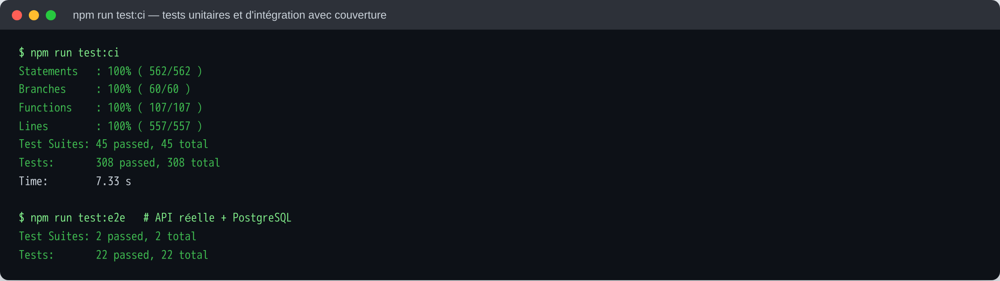

La couverture atteint **100 % sans base de données**, donc la CI n'a pas besoin de PostgreSQL. Elle échoue sous 95 %. Les rapports `lcov.info` (SonarQube), `sonar-report.xml` (SonarQube) et `junit.xml` (Jenkins) sont produits par `npm run test:ci`.

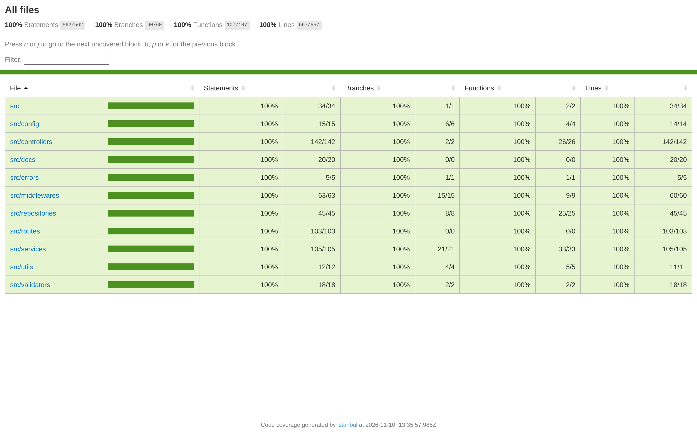

**Quality Gate « SouverainRecrut »** (`ci/sonar/setup-quality-gate.sh`, appliqué au nouveau code **et** au code global) :

| Condition | Seuil |
|---|---|
| Fiabilité, sécurité, maintenabilité | note A |
| Security hotspots revus | 100 % |
| Couverture | ≥ 80 % |
| Duplication | ≤ 3 % |

Première analyse : 13 code smells et 1 hotspot (`X-Powered-By`), tous corrigés. Le gate a aussi été **vérifié en échec** : sans rapport de couverture, il passe à FAILED et la pipeline s'arrête.

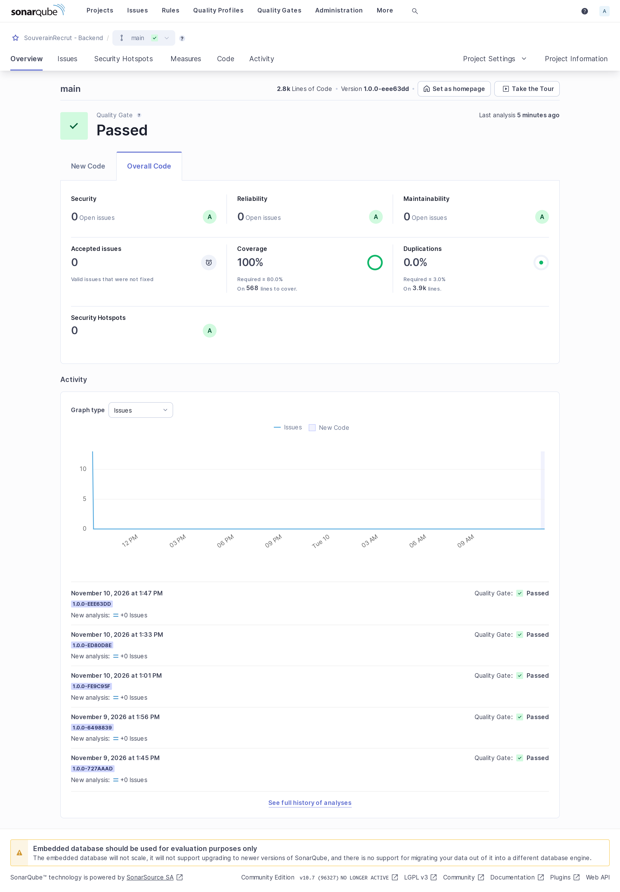

---

## 4. Intégration continue : Jenkins

Jenkins est entièrement décrit par du code : `ci/jenkins/Dockerfile` (Node 22, CLI Docker + buildx, Trivy vérifié par SHA-256), `plugins.txt` et `casc.yaml` (administrateur, serveur SonarQube, credentials, job). Le job scrute la branche `Dev`.

| Étape | Rôle | Bloquante |
|---|---|---|
| Checkout Dev | Récupère le commit, calcule le tag `<version>-<commit>` | — |
| Install, Prisma generate | `npm ci` (lockfile), client Prisma | oui |
| Tests | `typecheck` + `test:ci`, publication JUnit et couverture HTML | oui |
| SonarQube analysis | Analyse avec version = tag | oui |
| Quality Gate | Attend le verdict par webhook | **oui** |
| Build image | `docker buildx build --platform linux/amd64` | oui |
| Trivy scan | Rapport complet archivé, puis contrôle bloquant | **oui** |
| Publish | `docker login` (credential Jenkins), push `<version>-<commit>` et `dev` | uniquement si tout est vert |

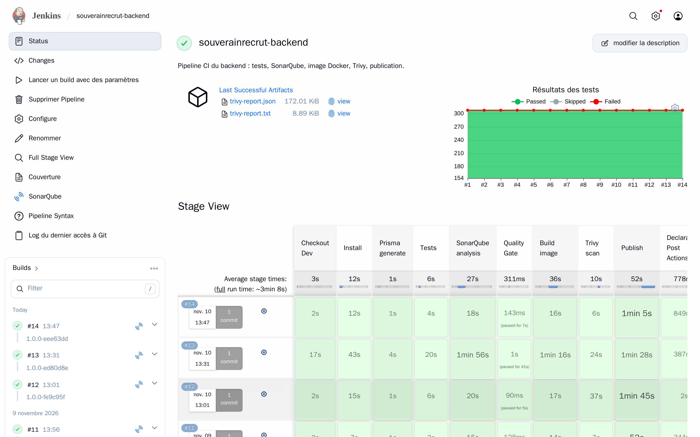

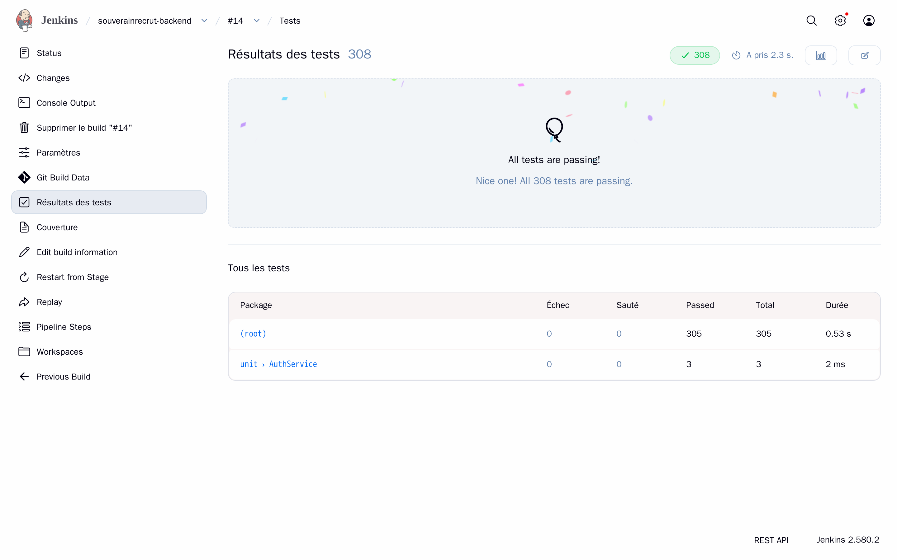

---

## 5. Image Docker et sécurité

| Exigence | Mise en œuvre (`backend/Dockerfile`) |
|---|---|
| Reproductible | Image de base figée par version **et** digest, `npm ci` sur le lockfile |
| Minimale | Build multi-étapes, dépendances de production seulement, `npm`/`npx` retirés de l'image finale, `.dockerignore` strict |
| Sans secret | `.env` exclu du contexte ; secrets fournis au lancement ; Trivy recherche les secrets |
| Sûre | Utilisateur `node` (non root), `HEALTHCHECK` |
| Traçable | Tag `<version>-<commit>` + labels OCI `version` et `revision` (commit complet) |
| Compatible | Construite pour `linux/amd64`, l'architecture du serveur (Jenkins tourne sur un Mac arm64) |

**Seuils Trivy**

| Catégorie | Décision |
|---|---|
| HIGH / CRITICAL avec correctif | **bloquant** |
| Secret détecté | **bloquant** |
| MEDIUM / LOW, ou sans correctif | rapport archivé, non bloquant |
| Exception | `backend/.trivyignore.yaml` : justifiée, limitée à un paquet et une version, **date d'expiration** |

Le premier scan a bloqué la pipeline sur 26 vulnérabilités HIGH. Traitement : `npm` retiré de l'image, dépendances transitives mises à jour (versions publiées depuis au moins 2 semaines), Prisma 6.19.3. Une seule exception subsiste : `deepmerge-ts` (CVE-2026-40345). Elle n'est chargée que par la CLI Prisma pour lire sa configuration, jamais sur une entrée utilisateur ; le correctif n'existe qu'en version 8, que Prisma 6 ne supporte pas. Elle expire le 09/02/2027.

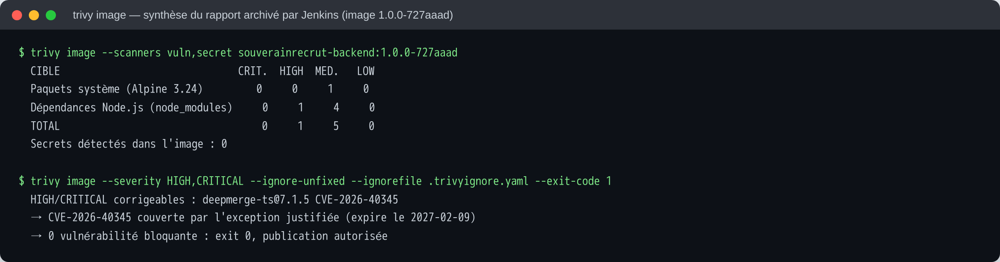

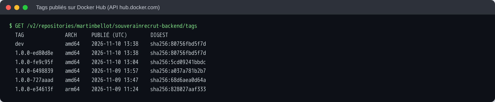

> La page web de Docker Hub bloque les navigateurs automatisés (Cloudflare) : la liste ci-dessus est construite à partir de l'API publique de Docker Hub. On y voit `1.0.0-e34613f` en arm64 : c'est la publication antérieure au correctif d'architecture (§ 11).

---

## 6. Infrastructure : Terraform et Ansible

**Terraform** (`terraform/`). Sans ESXi/vCenter, le provider vSphere est inutilisable. Terraform gère donc les ressources réellement disponibles autour du VPS :

| Ressource | Rôle |
|---|---|
| `tls_private_key` | Paire de clés SSH dédiée au déploiement (clé privée hors dépôt, dans `.secrets/`) |
| `null_resource` + `remote-exec` | Contrôle du serveur en lecture seule : OS, architecture, IP, accès Internet |
| `local_file` | Génère `ansible/inventory.ini` et les variables Ansible |

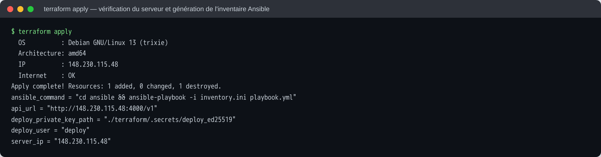

**Ansible** (`ansible/playbook.yml`), `ansible-playbook -i inventory.ini playbook.yml` :

| Étape | Détail |
|---|---|
| Système | Mise à jour APT ; `needrestart` en mode liste (aucun service redémarré) ; redémarrage signalé, jamais forcé |
| Docker | Docker et Compose existants conservés ; sinon, installation de Docker CE depuis le dépôt officiel. Service activé et vérifié |
| Accès | Utilisateur `deploy` (groupe docker) avec la clé générée par Terraform |
| Application | `/opt/souverainrecrut` (0750), fichiers de `deployment/`, secrets initiaux générés **sur le serveur** (0600), compte admin |
| Réseau | ufw : port 4000 ouvert |
| Contrôle | Conteneurs, `/v1/ready` depuis le serveur, `/v1/health` depuis l'extérieur |

Le playbook est **idempotent** : un second passage ne change rien (`changed=0`).

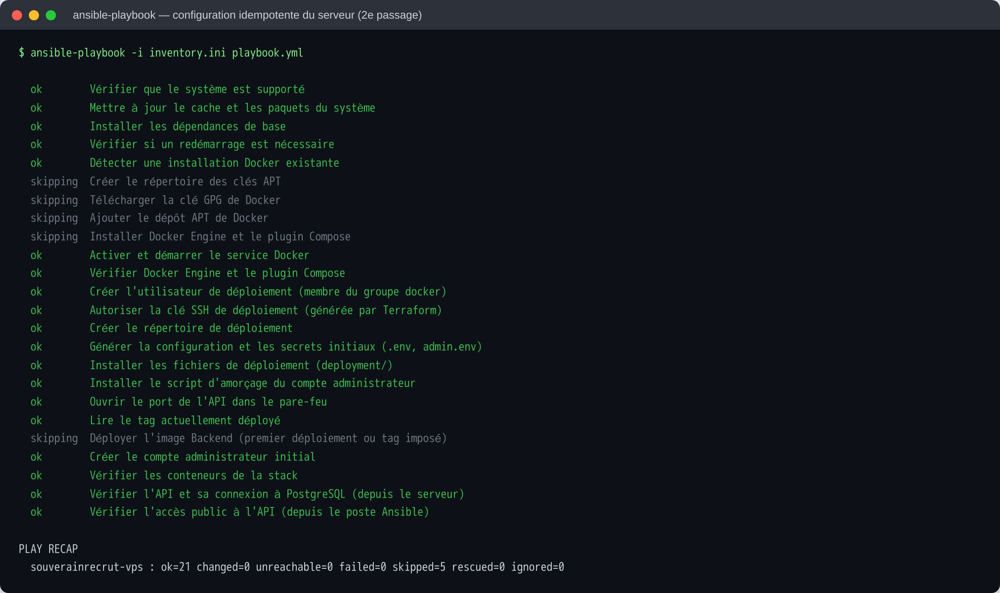

---

## 7. Déploiement : Docker Compose et GitLab CI

**`deployment/docker-compose.yml`**

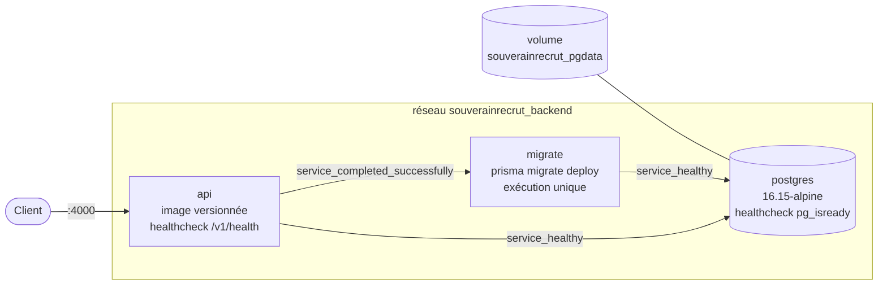

| Exigence 5.2 | Mise en œuvre |
|---|---|
| Image versionnée | `${BACKEND_IMAGE}:${IMAGE_TAG}`, tag dans `release.env` écrit par `deploy.sh` |
| Variables API et Prisma | `DATABASE_URL`, `JWT_SECRET`, `PORT`… depuis `.env` (modèle : `.env.example`) |
| Persistance et réseau | Volume nommé `pgdata` ; réseau dédié ; PostgreSQL **non exposé** |
| Redémarrage et santé | `restart: unless-stopped` ; healthchecks PostgreSQL et API ; rotation des logs |
| Migrations maîtrisées | Service `migrate` exécuté avant chaque démarrage de l'API ; `migrate deploy` n'applique que les migrations versionnées (jamais de reset) ; **sauvegarde `pg_dump` automatique avant** |

**`deployment/deploy.sh`** : sauvegarde → `pull` → `up` (migrations puis API) → contrôle de santé → historique. En cas d'échec, il revient automatiquement à la version précédente.

**Pipeline GitLab** (`gitlab-deploy/.gitlab-ci.yml`)

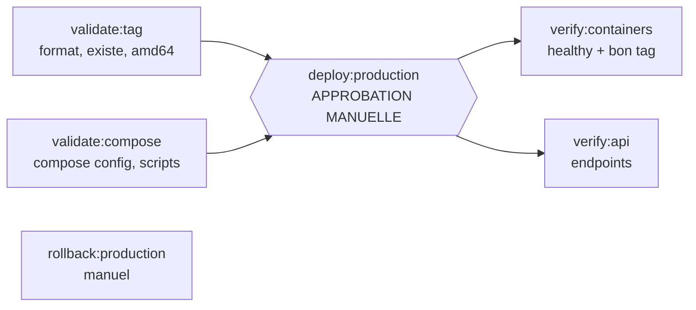

| Exigence 5.3 | Mise en œuvre |
|---|---|
| Valider le tag | Format `<version>-<commit>`, présence sur Docker Hub, architecture amd64 |
| Connexion SSH | Agent SSH + clé (variable *File*), hôte vérifié par `known_hosts` |
| Transmettre fichiers et configuration | `scp` de `deployment/` et du `.env` généré depuis les variables protégées |
| Récupérer l'image | `docker login` (token par stdin) puis `docker compose pull` |
| Démarrer ou mettre à jour | `./deploy.sh <tag>` |
| Vérifier | Conteneurs `healthy` sur le bon tag ; `/health`, `/ready`, `/info`, `/api-docs`, 401 sans token, 400 sur login invalide |
| Approbation | Job `deploy:production` en `when: manual` : le pipeline reste bloqué jusqu'à validation |

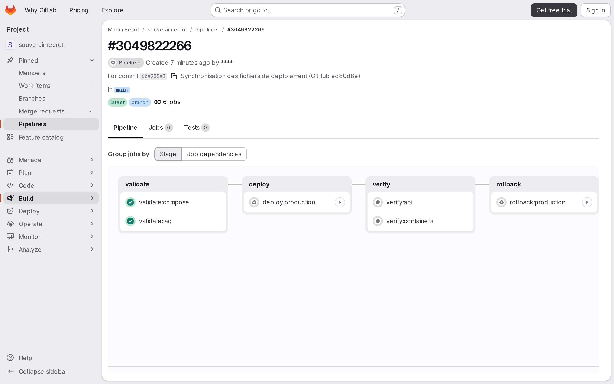

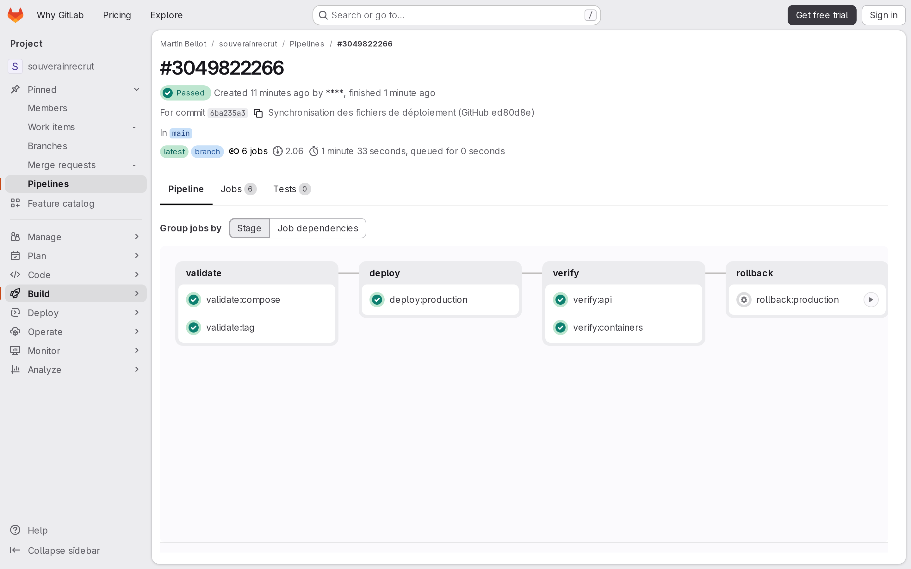

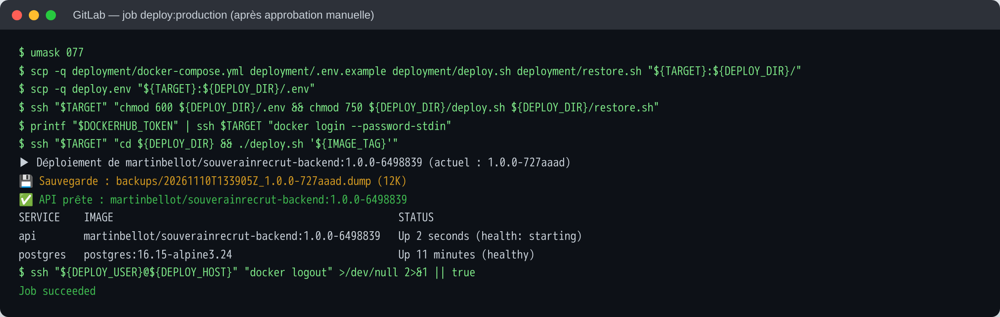

---

## 8. Vérification, rollback et données

**Cheminement complet d'une modification** (exemple réel du commit `727aaad`) :

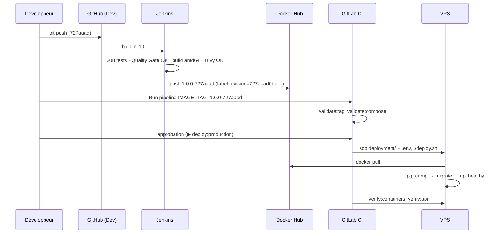

Sur le serveur, la version en service se retrouve depuis le conteneur lui-même : `docker inspect souverainrecrut-api-1` donnait `revision=727aaad0bb150b3c2fb76200c970e73a5d4061e7`. **Version en production à la remise : `1.0.0-eee63dd`**, déployée par le même pipeline GitLab (historique complet dans `/opt/souverainrecrut/release.history`).

**Vérifications réalisées sur le serveur**

| Vérification | Résultat |
|---|---|
| Endpoints principaux | `/health` UP, `/ready` READY + base CONNECTED, `/info`, Swagger, login admin, création et suppression de candidat, 401 sans token |
| Communication API ↔ PostgreSQL | `/ready` exécute `SELECT 1` ; écriture et lecture via l'API |
| Persistance | Donnée témoin conservée après `docker compose down` puis redémarrage |
| Sauvegarde et restauration | Donnée supprimée, puis restaurée depuis la sauvegarde automatique |
| Rollback | `1.0.0-6498839` → `1.0.0-727aaad` par le job GitLab ; donnée témoin intacte |
| Retour automatique | Tag inexistant : aucun changement. Image incompatible : retour automatique à la version précédente |

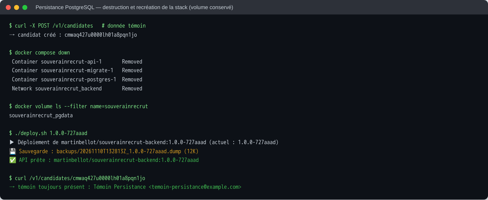

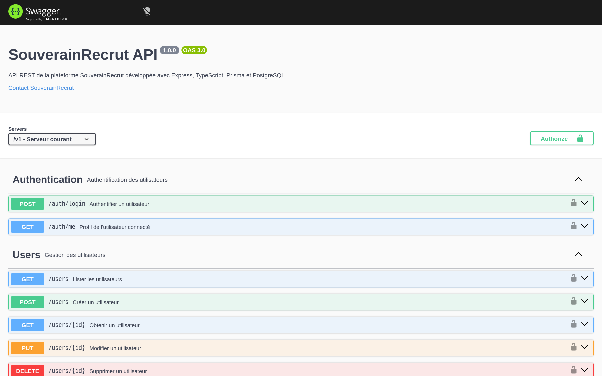

**Procédure de rollback** (trois niveaux)

| Situation | Action | Données |
|---|---|---|
| Le déploiement échoue (image, migration, santé) | **Automatique** : `deploy.sh` remet la version précédente | inchangées |
| Défaut fonctionnel constaté après un déploiement réussi | GitLab : job **`rollback:production`**, ou *Run pipeline* avec `IMAGE_TAG` = version précédente (liste dans `release.history` ou sur Docker Hub) | inchangées |
| La migration de la nouvelle version a cassé le schéma ou les données | Rollback applicatif, **puis** `./restore.sh <sauvegarde> --yes` | données écrites après la sauvegarde **perdues** |

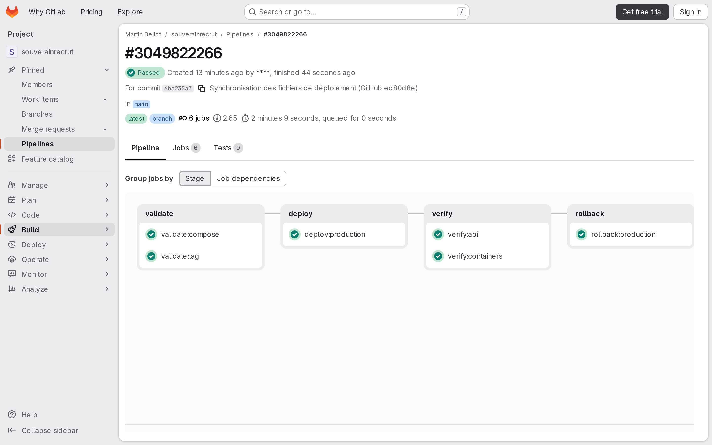

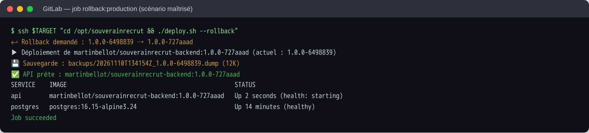

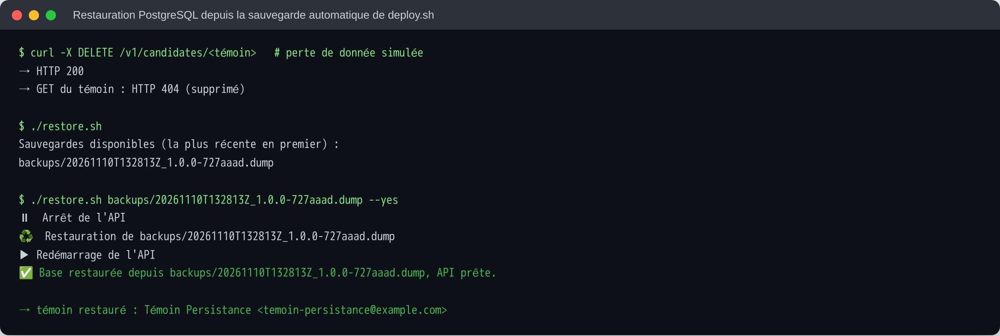

**Migrations et réversibilité.** Un rollback applicatif ne défait pas une migration Prisma : l'ancienne version de l'API tourne alors sur le nouveau schéma. Règles retenues :
- **Migrations additives (expand / contract)** : ajouter une colonne ou une table d'abord, compatible avec l'ancien code ; ne supprimer ou renommer que dans une version ultérieure, quand plus aucune version déployée n'en dépend. Le rollback reste alors sûr.
- **Sauvegarde avant chaque déploiement** (`deploy.sh`, 7 conservées) : c'est le filet de sécurité quand une migration n'est pas réversible.
- `migrate deploy` uniquement en production, jamais `migrate dev` ni `reset`.

---

## 9. Gestion des secrets

| Secret | Stocké dans | Utilisé par |
|---|---|---|
| Token Docker Hub (publication) | Credential Jenkins (JCasC, depuis `ci/.env` non versionné) | étape Publish |
| Token SonarQube | Credential Jenkins | analyse |
| Token Docker Hub (pull) | Variable GitLab **protégée, masquée et cachée** | `deploy:production` |
| Clé SSH de déploiement | État Terraform local + variable GitLab de type *File* | jobs SSH |
| `POSTGRES_PASSWORD`, `JWT_SECRET` | Variables GitLab masquées et cachées → `.env` 0600 sur le serveur | stack |
| Mot de passe admin de l'API | `admin.env` 0600 sur le serveur | exploitation |

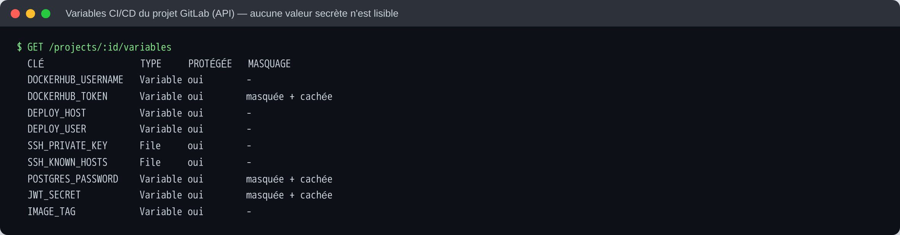

**Contrôles effectués** : aucun motif de secret ni aucune valeur réelle dans les 13 commits de l'historique Git ; 0 occurrence des 4 secrets dans les journaux des jobs GitLab ; pas de `set -x` ; token transmis par stdin ; `.env` créé en 0600 puis supprimé du runner.

---

## 10. Conformité aux exigences

| Exigence | Attendu | Preuves |
|---|---|---|
| **Reproductibilité** | Build, configuration et déploiement décrits et rejouables | `Jenkinsfile`, JCasC, Dockerfile figé par digest, Terraform, playbook idempotent (`changed=0`), `deployment/`, `.gitlab-ci.yml`, `capture.py` — § 4 à 7 |
| **Qualité logicielle** | Tests exécutés, couverture et SonarQube consultables | 330 tests, 100 % de couverture, rapport HTML dans Jenkins, Quality Gate PASSED — § 3 |
| **Sécurité** | Secrets protégés, image analysée par Trivy | Variables protégées, masquées et cachées, credentials Jenkins, historique et journaux vérifiés ; Trivy bloquant avec seuils documentés — § 5, § 9 |
| **Traçabilité** | Tag explicite relié à une version du code | `<version>-<commit>`, labels OCI `revision`, version SonarQube = tag, `release.history` — § 5, § 8 |
| **Déploiement** | Le serveur récupère l'image publiée, l'API démarre avec PostgreSQL | `docker pull` depuis Docker Hub (aucun build sur le serveur), migrations puis API `healthy` — § 7 |
| **Continuité** | Rollback documenté | Trois niveaux de rollback testés + sauvegarde et restauration — § 8 |
| **Documentation** | Choix, prérequis et procédures expliqués | Ce rapport, `README.md`, `gitlab-deploy/README.md`, commentaires des fichiers — § 13 |

---

## 11. Défauts détectés et corrigés

Les tests et les déploiements réels ont révélé des défauts. Chacun a été corrigé, puis revérifié.

| Origine | Défaut | Correction |
|---|---|---|
| Base de données | La migration ne correspondait pas au schéma : pas de suppression en cascade, pas d'unicité des candidatures | Migration corrective |
| Sécurité API | Hash des mots de passe renvoyé par `/users` ; mot de passe enregistré **en clair** à la mise à jour | Sélection sans mot de passe ; hachage systématique |
| Robustesse API | Erreurs 500 sur données invalides (Prisma, JSON, login, pagination) | Codes 400/404/409/413 et validation Zod |
| Configuration | Démarrage possible sans `JWT_SECRET` ; port exposé ≠ port d'écoute | Arrêt au démarrage ; `PORT=4000` |
| SonarQube | 13 code smells, 1 hotspot, nom de projet mal encodé | Corrigés |
| Trivy | 26 vulnérabilités HIGH (dont `proxy-addr`, `npm` embarqué) | Mises à jour, `npm` retiré, exception datée |
| Architecture | Image publiée en **arm64** (Jenkins sur Mac), alors que le serveur est en amd64 | Build `buildx --platform linux/amd64` + contrôle dans GitLab |
| Déploiement | Retour arrière inopérant (`set -e`) ; échec après un `compose down` (variable manquante, base arrêtée pendant la sauvegarde) | Script corrigé et revérifié |
| GitLab | YAML invalide (`: ` lu comme une clé) | Détecté par le lint, corrigé |
| CI | Avertissement Jest en CI (13 workers sur 14 cœurs) | `--maxWorkers=2` |

> Deux de ces tests ont coupé l'API SouverainRecrut pendant quelques minutes, ce qui a permis de corriger `deploy.sh`. Les autres services du serveur n'ont jamais été touchés.

---

## 12. Limites et pistes

| Limite | Piste |
|---|---|
| Jenkins et SonarQube tournent sur le poste de développement | Les héberger sur un serveur CI dédié, avec un webhook GitHub à la place de la scrutation |
| SonarQube 10.7 n'est plus maintenu et utilise sa base embarquée (réservée à l'évaluation) | Version LTA courante avec une base PostgreSQL dédiée |
| Coupure d'environ 30 s à 1 min pendant un déploiement ou un rollback | Déploiement blue/green derrière un reverse proxy |
| API en HTTP sur le port 4000 | HTTPS via un reverse proxy et un nom de domaine |
| `deploy` est membre du groupe `docker`, ce qui équivaut à des droits root | Docker rootless, ou commande SSH forcée vers `deploy.sh` |
| Exception Trivy `deepmerge-ts` | Migrer vers Prisma 7 |
| Sauvegardes conservées sur le serveur lui-même | Les copier hors du serveur (stockage objet) |

---

## 13. Procédures de référence

**Prérequis** : Docker, Node 22, Terraform ≥ 1.6, Ansible ≥ 2.16, un accès SSH root au serveur (agent SSH), des comptes GitHub, GitLab (vérifié) et Docker Hub.

| Objectif | Commandes |
|---|---|
| Lancer Jenkins + SonarQube | `cp ci/.env.example ci/.env` (renseigner) · `docker compose -f docker-compose.ci.yml up -d --build` · `SONAR_HOST_URL=… SONAR_ADMIN_TOKEN=… ci/sonar/setup-quality-gate.sh` |
| Tester en local | `cd backend && npm ci && npm test` · E2E : `npm run test:db:up && npm run test:e2e` |
| Provisionner | `cd terraform && terraform init && terraform plan && terraform apply` |
| Configurer le serveur | `cd ansible && ansible-playbook -i inventory.ini playbook.yml -e image_tag=<tag>` |
| Préparer GitLab | `./gitlab-deploy/setup-variables.sh <tag>` · `./gitlab-deploy/sync.sh` |
| Déployer | GitLab → *Run pipeline* (`IMAGE_TAG=<tag>`) → ▶ `deploy:production` |
| Revenir en arrière | GitLab → ▶ `rollback:production` (ou *Run pipeline* avec l'ancien tag) |
| Restaurer la base | Sur le serveur : `./restore.sh` (liste) puis `./restore.sh backups/<fichier>.dump --yes` |
| Observer | `docker compose --env-file .env --env-file release.env ps` · `… logs -f api` |
| Refaire les captures | voir l'en-tête de `docs/captures/capture.py` |
