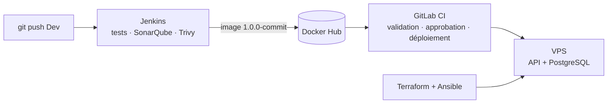

# SouverainRecrut

Plateforme de gestion des recrutements (candidats, offres, candidatures), projet fil rouge du cours DevOps.
Ce dépôt contient l'API Backend et **toute sa chaîne de livraison** : tests, qualité, intégration continue, image Docker, provisionnement et déploiement.

➡️ **Documentation complète : [RAPPORT.md](RAPPORT.md)**



| | |
|---|---|
| API en production | http://148.230.115.48:4000/v1/info · [Swagger](http://148.230.115.48:4000/api-docs/) |
| Image Docker | [martinbellot/souverainrecrut-backend](https://hub.docker.com/r/martinbellot/souverainrecrut-backend) |
| Projet de déploiement | [gitlab.com/martin.bellot.off/souverainrecrut](https://gitlab.com/martin.bellot.off/souverainrecrut) |

## Arborescence

| Dossier | Contenu |
|---|---|
| `backend/` | API Express + Prisma, 330 tests (couverture 100 %), Dockerfile |
| `Jenkinsfile`, `ci/` | Pipeline CI, image Jenkins configurée en code, Quality Gate SonarQube |
| `terraform/` | Clé de déploiement, contrôle du serveur, inventaire Ansible |
| `ansible/` | Configuration du serveur et installation initiale |
| `deployment/` | `docker-compose.yml`, `.env.example`, `deploy.sh`, `restore.sh` |
| `gitlab-deploy/` | Pipeline de déploiement GitLab et scripts de synchronisation |
| `docs/captures/` | Captures du rapport |

## Démarrage rapide

```bash
# Backend en local
cd backend && npm ci && npm test

# Jenkins + SonarQube
cp ci/.env.example ci/.env   # renseigner les secrets (fichier non versionné)
docker compose -f docker-compose.ci.yml up -d --build

# Infrastructure
cd terraform && terraform init && terraform apply
cd ../ansible && ansible-playbook -i inventory.ini playbook.yml -e image_tag=<tag>
```

Déploiement et rollback : depuis GitLab (*Run pipeline* avec `IMAGE_TAG`, puis ▶ `deploy:production` ou `rollback:production`). Voir le [§ 13 du rapport](RAPPORT.md#13-procédures-de-référence).

## Auteurs

Projet de base : Alimou DIALLO · Chaîne CI/CD : Martin BELLOT (M2, SUP DE VINCI Rennes)
